<div align="center">


# DeskGadget

**A liquid-glass control panel for your Windows PC — one page per module, on a phone you already own.**

Windows server · Android client · plugins anyone can write

</div>

> **Built to be better than DeskThing.** DeskThing proved the idea: a small screen
> on your desk showing your PC. DeskGadget takes the same idea and removes the
> two things that hold it back — you never rebuild the app to add a module, and
> you choose exactly which modules each device sees. Everything is declarative
> data over one WebSocket, so a new plugin is a folder on the PC.

---


## Watch The story behind the deck.


https://github.com/user-attachments/assets/92a8c61b-5b16-4d60-b0ac-5233fafa8866


---

## Screenshots

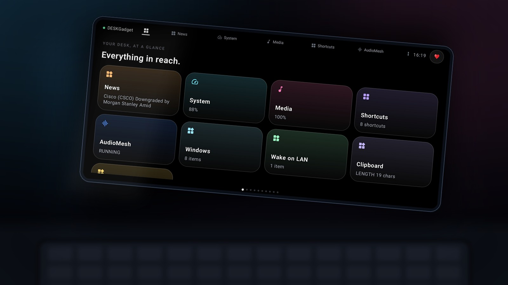


| Home — every module at a glance | Media — now playing, volume, mics |
|---|---|
| 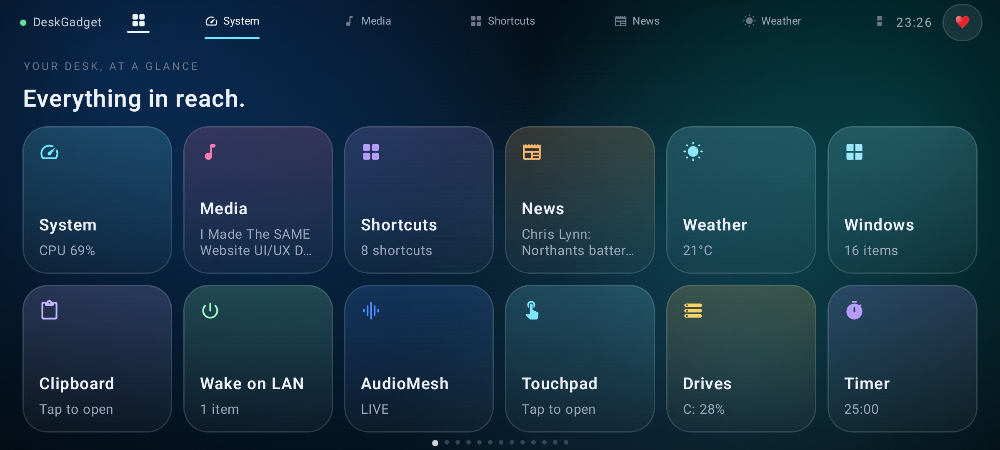 | 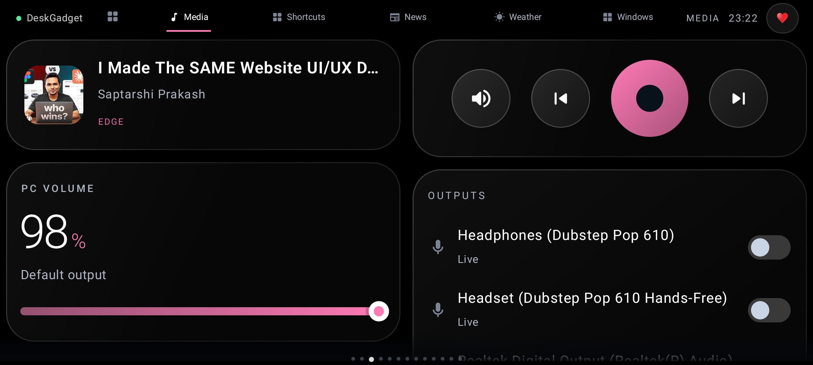 |

| News — with your own topics | Weather — today, next hours, this week |
|---|---|
| 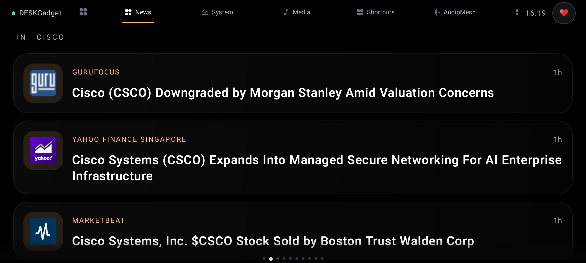 | 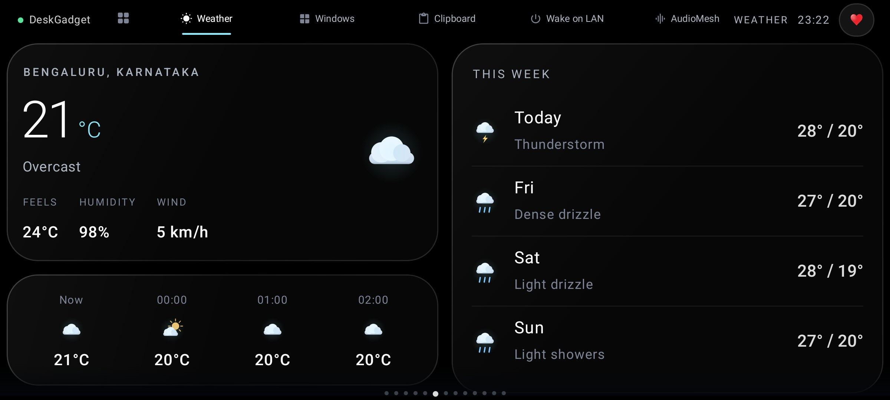 |

| Windows — switch what is in front | Shortcuts — launch anything |
|---|---|
| 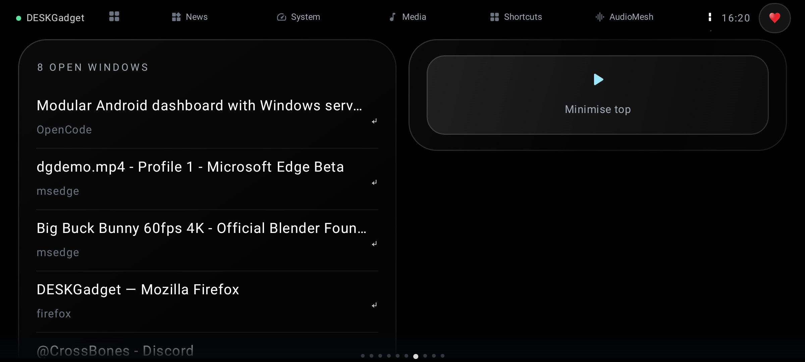 | 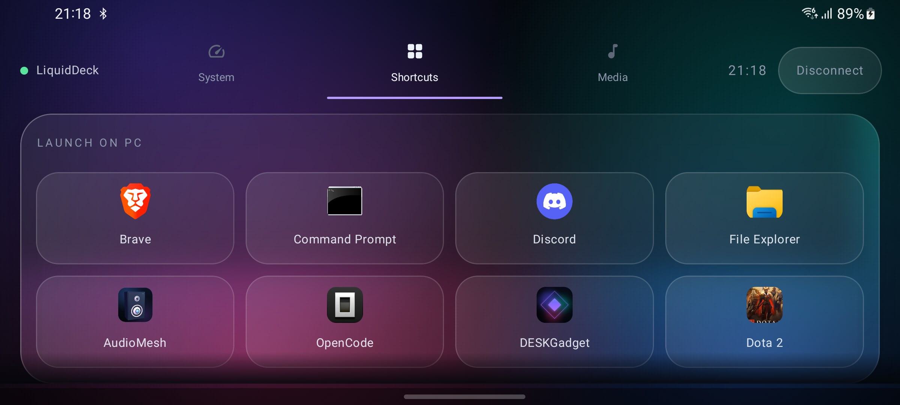 |

| Clipboard — both ways | Wake on LAN |
|---|---|
| 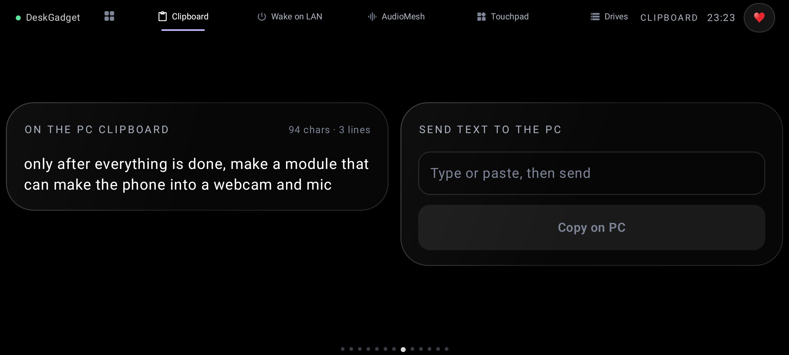 | 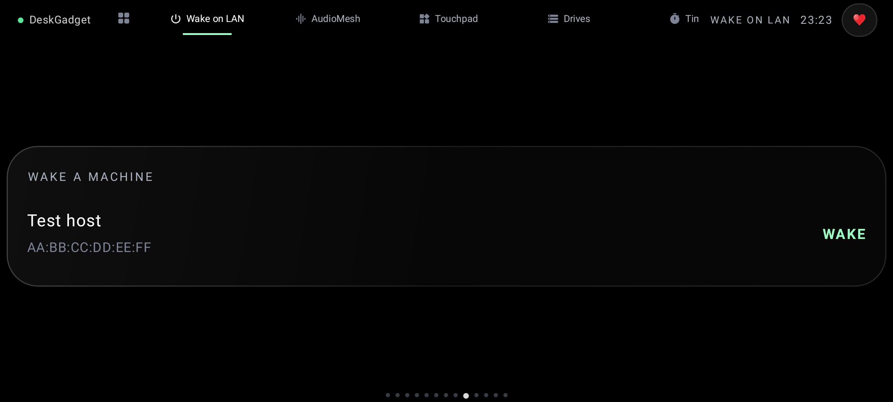 |

| System | Drives |
|---|---|
| 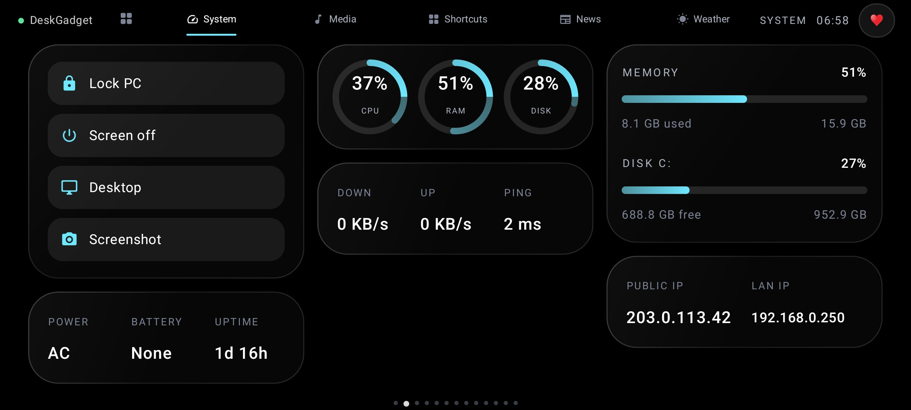 | 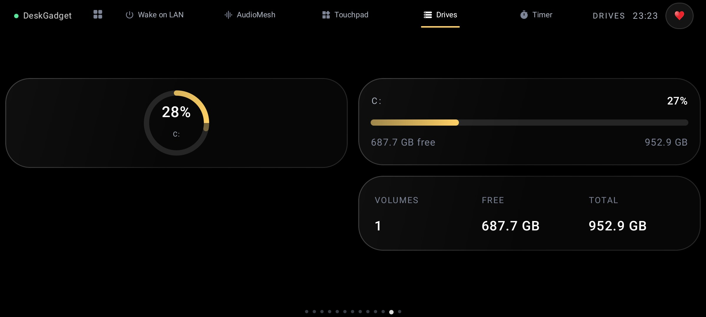 |

| Touchpad — the phone as a mouse | Dashboard |
|---|---|
| 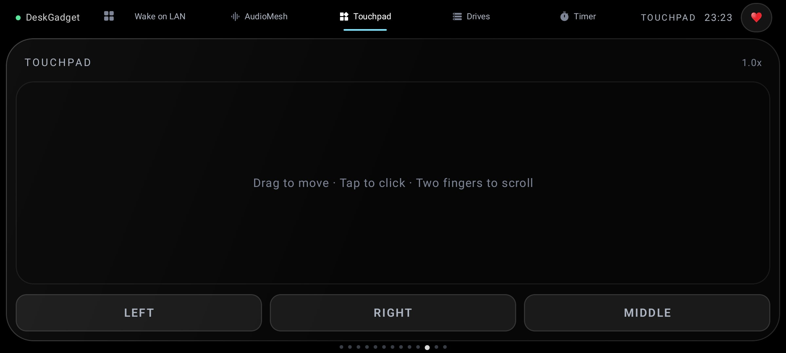 | 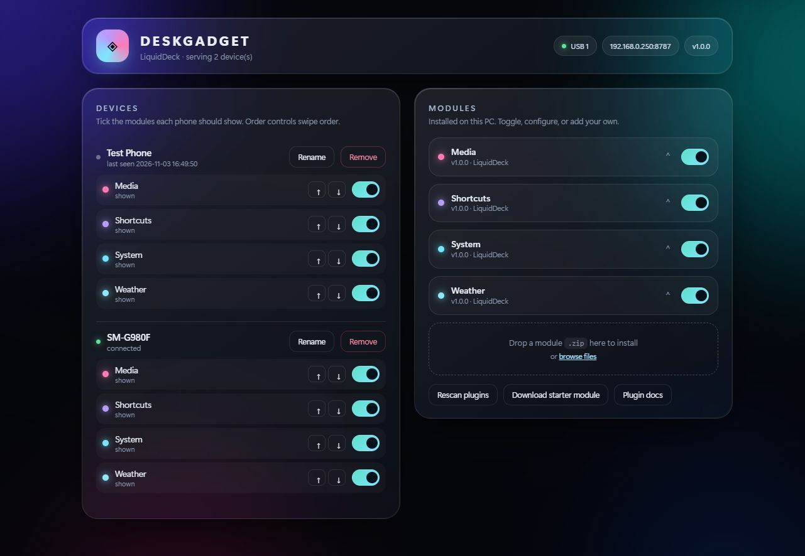 |

| OLED Black | White |
|---|---|
| 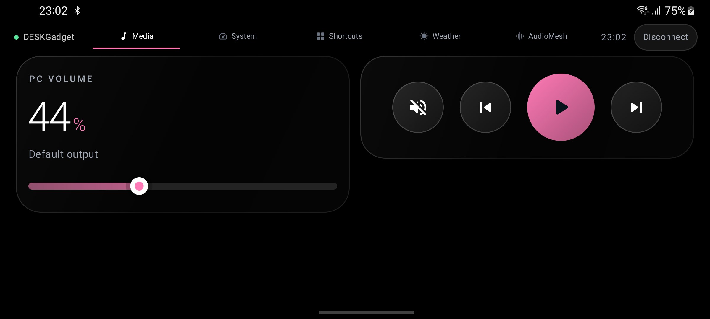 | 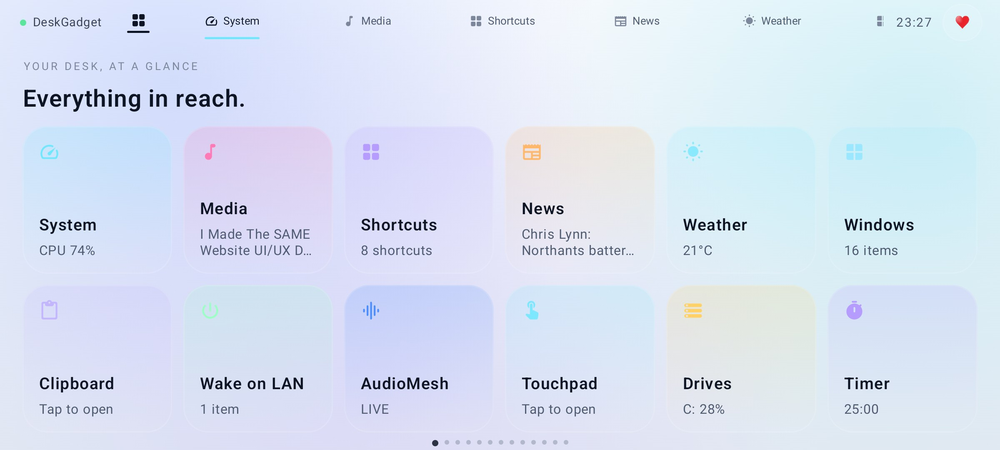 |

| Sunset | Ocean |
|---|---|
| 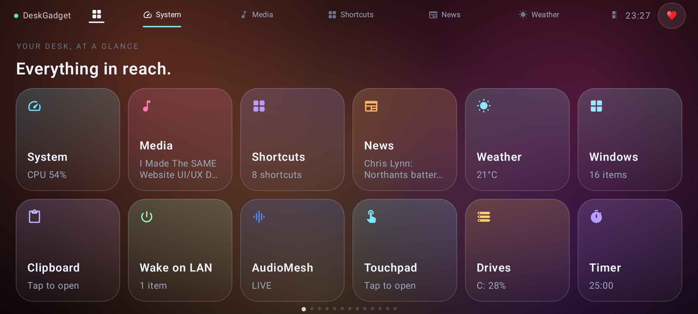 | 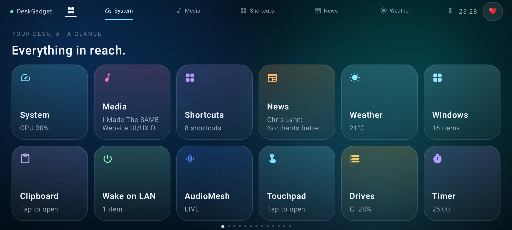 |

---

## Why another one?

| | DeskThing | DeskGadget |
|---|---|---|
| Adding a module | ships code for the client | **declarative blocks, no app rebuild** |
| Module choice | one layout for all devices | **per-device tick list + drag order** |
| Plugin authoring | TypeScript project | **a folder with `manifest.json` + `module.py`** |
| Plugin install | rebuild / restart | **drop a zip on the dashboard, hot reload** |
| Themes | dark | **six, including true OLED black and a light one** |
| Media | volume + transport | **+ per-output and per-microphone mute** |
| Games | manual shortcuts | **Steam libraries scanned automatically, cover art fetched** |
| Transport | polling in places | **push-only WebSocket for both phone and dashboard** |
| Output | — | **one installer, one APK, no Python required** |

## Modules

| Module | What it does |
|---|---|
| **System** | CPU, RAM and disk rings, live network throughput, public/LAN IP, latency, battery or AC state, uptime, plus quick actions (lock, screen off, desktop, screenshot) |
| **Media** | Now playing with artwork and seek, PC volume, transport, mute **each output**, mute **each microphone** |
| **News** | Multi-region, multi-topic headlines with publisher logos, plus **free-text topics of your own**; tap opens the article on the PC, in front |
| **Shortcuts** | Launch Windows apps; **Steam games detected automatically** with cover art |
| **Windows** | Every open window with its app icon, in two columns; tap to bring it forward |
| **Wake on LAN** | Magic packet to another machine, straight from the panel |
| **Clipboard** | Read the PC clipboard, and send text back to it from the phone |
| **Weather** | Current conditions with feels-like/humidity/wind, the next hours, and a 4-day outlook, no API key |
| **Drives** | Every volume with a free space bar and totals |
| **Timer** | Countdown / Pomodoro with start, +5, reset |
| **Touchpad** | The phone as a trackpad: drag to move, tap to click, two fingers to scroll, right/middle buttons |
| **AudioMesh** | Example third-party module (ship your own the same way) |

Each is its own swipeable page, and the home grid shows every enabled module with
its live value. Tick only what a given phone should show.

### Adding and removing modules

**Add or remove modules** in the dashboard lists everything in
[`catalog.json`](catalog.json) — the bundled set plus anything published to this
repo. Each module row also has a bin button. Add installs it (downloads
`manifest.json` + `module.py` if it is not already on disk); remove moves it to
`plugins_removed/` so it can be added back later. Modules you removed are never
re-seeded by an upgrade.

## Architecture

```
server/                 Python 3.11+ — FastAPI + WebSocket
  core/                 protocol, hub, plugin loader, adb bridge, launcher
  plugins/<id>/         manifest.json + module.py
  dashboard/            the glass dashboard served at :8787
android/                Kotlin + Jetpack Compose, minSdk 26
packaging/              launcher, installer, PyInstaller build, icon extractor
docs/screenshots/       the images above
```

**Transport is push-only.** The phone holds one WebSocket; the server samples each
module on its interval and sends a rendered page only when it changed. Controls
travel back on the same socket and the module pushes again immediately. The
dashboard has its own socket (`/ws/dashboard`); nothing polls in a loop.

**The phone is a renderer.** Modules emit a tree of blocks — `hero`, `gauges`,
`sparkline`, `meters`, `kv`, `list`, `note`, `hours`, `controls`, `slider`,
`shortcuts`, `news`, `toggles`, `touchpad` — and the app draws them. Adding a
module therefore never requires an app update, which is the whole point.

## Install

**Windows** — run `DeskGadget-Setup.exe` from [Releases](../../releases). It installs
to `%LOCALAPPDATA%\DeskGadget`, adds Desktop and Start Menu shortcuts, and starts
the dashboard. No admin rights, **no Python required** (the interpreter and `adb`
are bundled).

**Android** — install `DeskGadget.apk` from Releases. It finds the server over
mDNS, over the UDP beacon, or over USB, and reconnects to whichever route is up.
Three transports work, and each remembers its own address:

- **Wi-Fi** — same network, discovered automatically.
- **USB tethering** — flip *USB tethering* on the phone; **no adb and no developer
  options** are needed.
- **USB + adb** — with USB debugging on, the server keeps
  `adb reverse tcp:8787 tcp:8787` alive and the phone connects to `127.0.0.1`.

See [docs/CONNECTING.md](docs/CONNECTING.md) for setup and troubleshooting.

```bash
# from source
pip install -r server/requirements.txt
python -m server.main        # dashboard at http://localhost:8787
```

## Writing a module

```python
# server/plugins/hello/module.py
from core.base import Module

class Module(Module):
    def page(self):
        return {"blocks": [
            {"type": "hero", "label": "HELLO", "value": "42", "unit": "%"}
        ]}
```

```json
// server/plugins/hello/manifest.json
{ "id": "hello", "name": "Hello", "accent": "#7CFFB2",
  "interval": 5, "settings": { "greeting": { "type": "string", "default": "hi" } } }
```

Then **Rescan** in the dashboard, or zip the folder and drop it in. See
[`server/PLUGINS.md`](server/PLUGINS.md) for every block and setting type.

## Themes

Liquid · Full Glass · OLED Black · White · Graphite · Aurora · Sunset · Ocean —
picked per device in the dashboard. The dashboard follows the same theme, applied
live, remembered across reconnects.

## Updates

The app checks the public releases feed at most once every three days. When a
newer build exists it shows the version and that release's changelog, and lets
you download or dismiss it. **Check for updates** in the support sheet (the
heart) runs the check on demand.

## Build

```bash
# android (JDK 17 or 21, SDK 35)
cd android && gradle assembleDebug

# windows installer (Python 3.11+, PyInstaller)
powershell packaging/fetch_adb.ps1
python packaging/build_exe.py     # dist/DeskGadget-Setup.exe
```

## Roadmap

- Phone camera as a Windows webcam — beta. Each phone appears as its own camera
  (`DeskGadget Camera - <phone>`) after one permission prompt, and its microphone
  streams along with the picture
- Home Assistant, GitHub notifications, Steam deals
- Per-module page layouts on the phone

## Support

DeskGadget is free and open source. If it earned a place on your desk:

**[Buy me a coffee](https://buymeacoffee.com/issac_john)**

---

## License

MIT — see [LICENSE](LICENSE).
